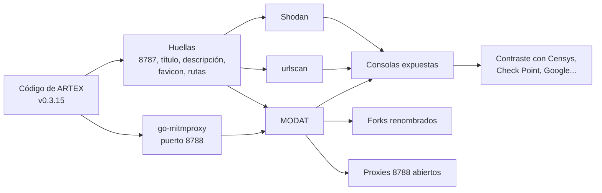

> **TLP:CLEAR** · Confianza global: **alta** en las huellas, **media** en la atribución de cada instancia · Investigación: 13 y 14 de noviembre de 2026 · Última actualización: 2026-11-14
{: .prompt-info .notranslate translate="no" }

> **Punto de partida y fuentes.** El análisis parte del código de ARTEX, en concreto de la copia pública [Hinln/ARTEX](https://github.com/Hinln/ARTEX), que conserva la versión 0.3.15 del repositorio original de **Autumn-27**, retirado por su autor en octubre de 2026. Las búsquedas en Shodan, urlscan y MODAT son mías. El contexto sobre el abuso de la herramienta procede de **CrowdStrike, Microsoft, Wiz, Google Threat Intelligence, Censys, Check Point** y otros, citados en cada punto y en las [referencias](#referencias).
{: .prompt-tip }

## Ideas clave

**ARTEX** es una plataforma de pentesting autónomo escrita en Go, con una consola web en Next.js, en la que varios agentes LLM planifican y ejecutan ataques por sí solos. Se publicó como código abierto en julio de 2026 y, en tres meses, pasó a usarse en ataques reales: bancos surcoreanos, el grupo chino **Storm-0940**, la campaña de **VAPOR PANDA** contra más de 200 organizaciones y grupos de extorsión.

A partir de su código he extraído las huellas que deja una consola expuesta y las he usado para buscarlas en Internet:

1. **Las huellas del código funcionan.** El título por defecto (`ARTEX — 自主渗透测试控制台`), la descripción, el favicon, el puerto **8787** y rutas como `/function/tasks` o `/api/auth/status` identifican las consolas en Shodan, urlscan y MODAT con muy pocos falsos positivos.
2. **Hay miles de consolas expuestas.** Shodan devuelve unas **2.000** y MODAT casi **4.000**, en la línea de lo que publicaron Censys (1.465) y Check Point (1.608 activas). Estados Unidos, Hong Kong y China concentran la mayoría en todas las fuentes.
3. **Los forks cambian el nombre, pero no la huella.** He encontrado variantes renombradas (**ScopeWeaver**, **AntiFox**, una versión coreana y otra en inglés) que conservan el mismo favicon, las mismas rutas y el mismo código de Next.js.
4. **El proxy de registro de tráfico también se expone.** ARTEX graba todo el tráfico de sus agentes con **go-mitmproxy** en el puerto **8788**. Hasta la versión 0.3.12 escuchaba por defecto en todas las interfaces, y MODAT encuentra **218 hosts** con ese servicio abierto: proxies que interceptan TLS y guardan el tráfico en claro.
5. **Los hashes del favicon, verificados.** El hash de Shodan (`-1898746557`) corresponde a `icon.png`, y el SHA256 que usa urlscan es el de `favicon.ico`.

## Contexto: de herramienta de pentesting a herramienta de ataque

### Qué es ARTEX

Según su propio README y la descripción que su autor publicó en el weekly de Ruan Yifeng, ARTEX recibe un objetivo y un alcance autorizado y, "como un equipo de Red Team real", planifica, reparte tareas y ejecuta la intrusión:

- Un **agente planificador** crea objetivos de exploración, varios **agentes de trabajo** los ejecutan (nmap, curl, Playwright, scripts) y el resultado vuelve a un **grafo** de activos, tráfico y hallazgos.
- Un **proxy de registro** captura todo el tráfico HTTP de los agentes como evidencia.
- Un sistema de **aprobaciones** detiene las acciones peligrosas hasta que un humano las autoriza.
- Funciona con modelos de Anthropic, OpenAI o cualquier API compatible, y se sincroniza con **ScopeSentry**, otra herramienta de reconocimiento del mismo autor.

Google Threat Intelligence lo describe como "una plataforma autónoma de pentesting y de C2 ofensivo, impulsada por LLM y con varios agentes".

### Del lanzamiento al abuso

| Fecha | Evento | Fuente |
|---|---|---|
| Julio de 2026 | Autumn-27 publica ARTEX en GitHub | Help Net Security, Infosecurity |
| Finales de agosto | Primeros usos maliciosos; búsquedas de secretos en GitHub | Google, Microsoft |
| Septiembre | Gana el reto "Agent+" de Baidu | Wiz |
| Finales de septiembre - principios de octubre | Robo de datos en bancos surcoreanos | CrowdStrike |
| 7 de octubre | Informe de CrowdStrike; versión 0.3.15 | CrowdStrike, CHANGELOG |
| 8 de octubre | El autor cierra el código, alegando el abuso. Ya hay más de 12.000 forks, según Wiz | Wiz, SOCRadar |
| 17 de octubre | Empieza la campaña de VAPOR PANDA: más de 200 organizaciones en 11 días | CrowdStrike |
| 21-22 de octubre | Storm-0940 usa ARTEX contra ConnectWise y otros proveedores de software | Microsoft, Wiz |
| 30 de octubre | Google detalla intrusiones de grupos de extorsión y otros con ARTEX | Google Threat Intelligence |
| 2-4 de noviembre | 62 consolas sirven una **imagen de Docker con puerta trasera** | The Hacker News, vía CSA |
| 5 de noviembre | Censys cuenta 1.465 consolas expuestas; Check Point, 1.608 | Censys, Check Point |
{: .notranslate translate="no" }

Los detalles de cada campaña están en las referencias. Lo relevante aquí es que **la consola de ARTEX es infraestructura de ataque**: los agentes ejecutan sus herramientas desde el mismo servidor, salvo que el operador configure un proxy.

## Punto de partida

El punto inicial es el código de [Hinln/ARTEX](https://github.com/Hinln/ARTEX), una copia de seguridad de la versión 0.3.15 que mantiene el historial y la licencia AGPL-3.0 del original. Lo uso para responder a una pregunta: **¿qué responde una consola de ARTEX cuando la escanea un servicio como Shodan?**

## Metodología

1. **Análisis del código**: puertos, títulos, textos, rutas, favicon y dependencias.
2. **Búsqueda de cada huella** en Shodan, urlscan y MODAT, y pivote entre ellas.
3. **Verificación**: revisión manual de resultados y cálculo de los hashes del favicon sobre el código.
4. **Contraste** con los informes públicos de Censys, Check Point, Google, CrowdStrike, Microsoft y Wiz.

Todo es pasivo: no he interactuado con ninguna consola.

<div class="notranslate" translate="no" markdown="1">



</div>

## Hallazgos

### 1. Las huellas que deja el código

**Puertos.** El `Dockerfile` expone el **8787** (consola web) y el **8788** (proxy de registro de tráfico):

{: w="600" }

**Título y descripción.** El fichero `web/src/config/app-config.ts` fija los metadatos de la página:

| Campo | Valor | Traducción |
|---|---|---|
| `title` | `ARTEX — 自主渗透测试控制台` | ARTEX — Consola de pentesting autónomo |
| `description` | `LLM 驱动的自主渗透测试系统控制台` | Consola del sistema de pentesting autónomo impulsado por LLM |
{: .notranslate translate="no" }


**Rutas.** `web/src/proxy.ts` define las páginas de autenticación (`/login` y `/setup`) y redirige al usuario ya autenticado a **`/function/tasks`**. La cookie de sesión se llama `artex_token`.


**Textos de la página de login** (`web/src/app/(auth)/login/page.tsx`):

- `正在检查登录状态…` ("Comprobando el estado de la sesión…").
- `欢迎回来，请输入密码以继续使用 ARTEX` ("Bienvenido de nuevo, introduce la contraseña para seguir usando ARTEX").
- El usuario es siempre `ARTEX`: el campo es de solo lectura.
- `ARTEX 使用须知与免责声明`, con `版本 v1.0 · 生效日期 2026-09-18` ("Aviso de uso y descargo de responsabilidad de ARTEX", "Versión v1.0 · En vigor desde 2026-09-18").


**La API de autenticación.** En `server/auth.go`, todo `/api/auth/*` queda fuera de la autenticación. **`GET /api/auth/status`** devuelve si ya se ha fijado la contraseña de administrador (`{"initialized": true|false}`), y `POST /api/auth/init` permite fijarla **solo la primera vez**. Por eso `/api/auth/status` aparece en todos los escaneos de urlscan, y por eso **una consola recién instalada y expuesta puede quedar en manos del primero que llegue**. No he comprobado el estado de ninguna consola: hacerlo supondría interactuar con ellas.

**El favicon.** He calculado los hashes de los iconos sobre el código:

| Fichero | Hash de Shodan (mmh3) | SHA256 (el que usa urlscan) |
|---|---|---|
| `web/src/app/icon.png` (= `web/public/logo.png`) | `-1898746557` | `30fcea978f7cef5a…` |
| `web/src/app/favicon.ico` | `-576220750` | `8b567c0244f2dbee…` |
{: .notranslate translate="no" }

El hash que Shodan asocia a las consolas, `-1898746557`, es el de **`icon.png`**, el icono de 1920×1920 que la página declara además del favicon. El de `favicon.ico`, `-576220750`, no lo he probado en Shodan.

### 2. Miles de consolas expuestas

**Shodan.** Las tres huellas principales dan resultados muy parecidos, lo que indica que identifican el mismo conjunto:

| Consulta | Resultados | Puerto principal |
|---|---|---|
| `http.title:"ARTEX — 自主渗透测试控制台"` | 1.998 | 8787 (1.420) |
| `http.favicon.hash:-1898746557` | 2.070 | 8787 (1.357) |
| `http.html:"LLM 驱动的自主渗透测试系统控制台"` | 2.084 | 8787 (1.465) |
{: .notranslate translate="no" }


**urlscan.** El facet analysis de Shodan por `ssl.cert.subject.cn` da dominios como `ai.cypherx.cn`, `qq.clickepro.com` o `artex.objchen.cn`:


urlscan tenía un escaneo de `ai.cypherx.cn` con la consola de ARTEX. El favicon de ese escaneo tiene el SHA256 `8b567c02…`, y desde ahí pivoté:

| Consulta en urlscan | Resultados |
|---|---|
| `hash:8b567c0244f2dbee787165aea9c4ddabaaafb0fdb3b29899ac898c60a589856b` | 507 |
| `page.title:"自主渗透测试控制台"` | 551 |
| `filename:"api/auth/status" AND filename:"function/tasks/index.txt"` | 545 |
{: .notranslate translate="no" }


**MODAT.** La búsqueda por título da **3.762 resultados** y la de la descripción, **3.958**. MODAT etiqueta la mayoría como producto `Artex`, lo que aumenta la confianza en la consulta.


**Contraste con los recuentos públicos.** Las cifras no son comparables entre sí, pero apuntan al mismo orden de magnitud y al mismo reparto geográfico:

| Fuente | Fecha | Consolas | Principales países |
|---|---|---|---|
| AhnLab (vía SOCRadar) | 6-oct-2026 | ~600 IPs | — |
| Censys | 4-nov-2026 | 1.465 (~815 tras agrupar duplicados) | EE. UU. 726, HK 387, China 177 |
| Check Point | 5-nov-2026 | 1.608 activas, 2.557 históricas | EE. UU. 882, HK 295, China 103 |
| Shodan (propia) | 14-nov-2026 | 1.998-2.084 | EE. UU. 1.006, HK 402, China 229 |
| MODAT (propia) | 14-nov-2026 | 3.762-3.958 | EE. UU. ~1.380, HK 688, China 506 |
{: .notranslate translate="no" }

Las diferencias se explican, al menos en parte, porque cada servicio cuenta distinto: Shodan cuenta servicios (una IP con dos puertos cuenta dos veces) y MODAT parece conservar un historial más largo. Censys advierte además de que **algunas consolas son de pentesters legítimos**.

### 3. Los forks cambian el nombre, pero no la huella

Tras el cierre del código, ARTEX sigue vivo a través de copias, traducciones y versiones renombradas. Google e Infosecurity Magazine citan **ScopeWeaver** y una versión de pago, **ARTEX PRO**. En MODAT, buscando la redirección de Next.js a `/function/tasks` y excluyendo lo etiquetado como ARTEX, aparecen **626 resultados** con otros nombres:

```text
http.body="NEXT_REDIRECT;replace;/function/tasks" AND product!="ARTEX"
```
{: .notranslate translate="no" }


| Variante | Título | Ejemplo |
|---|---|---|
| Versión coreana | `danny: 자율 침투 테스트 콘솔` | `5.231.240[.]5` |
| ScopeWeaver | `ScopeWeaver — Autonomous Penetration Testing Console` | `102.220.160[.]63` |
| AntiFox | `AntiFox — 自主渗透测试控制台` | `47.79.89[.]225` |
| Forks internacionalizados | `ARTEX — Autonomous Penetration Testing Console` y `ARTEX: Autonomous...` | `82.38.44[.]198`, `185.125.50[.]112` |
| "Bob Research Labs" | `Bob Research Labs: We're coming to root your server!` | `152.89.170[.]85` |
{: .notranslate translate="no" }


Lo que **sobrevive al cambio de nombre**:

- **El favicon y su marca de caché.** ScopeWeaver conserva `favicon.ico?favicon.1uboyqwm7-s27.ico`, el mismo que la versión original, y "Bob Research Labs" aparece en Shodan con el hash `-1898746557`.
- **Las rutas**: `/login`, `/function/tasks` y `/api/auth/status`.
- **Los nombres de los ficheros de Next.js**, como `1jexzsn2qdw84.js`, y las fuentes `GeistPixel`, mientras el fork no recompile la interfaz.
- **El tamaño de la página**: las consolas originales responden con `Content-Length: 14815`.

Sobre **"Bob Research Labs"**: urlscan registró `152.89.170[.]85` el 14 de noviembre a partir de una URL `/bins/kwari.arm5`, un nombre típico de los binarios de botnets IoT. No he podido comprobar si ese servidor distribuía malware o si la URL procede de una fuente de reportes automática, así que lo dejo como observación.


### 4. El proxy de registro, también expuesto

ARTEX graba todo el tráfico de sus agentes con [go-mitmproxy](https://github.com/lqqyt2423/go-mitmproxy) v1.9.2, declarado en `go.mod`:


Según `traffic/traffic.go`:

- El proxy se ofrece a los agentes como `HTTP(S)_PROXY` y **guarda cada petición y cada respuesta completas y en claro**, en SQLite con búsqueda de texto completo.
- **Intercepta TLS** con su propia CA (en `data/_ca`) y **no valida los certificados** de los objetivos (`SslInsecure: true`).

{: w="600" }

Si alguien le envía una petición normal en lugar de una de proxy, go-mitmproxy responde con un error **400** y el texto `此为代理服务器，不能直接发起请求` ("Esto es un servidor proxy; no se pueden hacer peticiones directas"), que ocupa exactamente los **48 bytes** del `Content-Length` que se ve en Shodan.


**La clave está en el CHANGELOG.** La versión **0.3.12 (17 de septiembre de 2026)** corrigió que "el proxy de registro de tráfico solo escuche por defecto en 127.0.0.1, para evitar exponer un proxy abierto en otras interfaces". Antes de esa versión, **el proxy escuchaba en todas las interfaces por defecto**. En la 0.3.15, el `docker-compose.yml` lo publica solo en `127.0.0.1:8788`, pero el `Dockerfile` arranca con `-proxy :8788`, así que lanzarlo con `docker run -p 8788:8788` sigue exponiéndolo.

MODAT encuentra **218 hosts** con ese servicio en el 8788:

```text
same_service(port=8788 protocol="http" transport="tcp" http.body="此为代理服务器，不能直接发起请求")
```
{: .notranslate translate="no" }


En los hosts que he revisado (`148.135.86[.]250`, `185.176.253[.]13`, `38.127.8[.]37`, `117.50.196[.]50`), el proxy en el 8788 convive con una consola de ARTEX en el 8787 o en otro puerto.


> **Por qué importa.** Un proxy de este tipo abierto a Internet es, probablemente, un **proxy abierto** que cualquiera podría usar, y todo lo que pase por él queda grabado en la base de datos del operador. Es una inferencia a partir del código: no lo he comprobado.
{: .prompt-warning }

El texto es de go-mitmproxy, no de ARTEX, así que por sí solo **no identifica ARTEX**: en Shodan, `http.html:"此为代理服务器，不能直接发起请求"` da 60 resultados, cualquiera de los cuales podría ser otro programa basado en go-mitmproxy. Combinarlo con el puerto 8788 y una consola en el mismo host es lo que le da valor.

### 5. Lo que acompaña a las consolas

MODAT etiqueta muchas de estas IPs como **maliciosas** y algunas además como **C2** o con **directorios abiertos**. Por ejemplo, `27.50.63[.]82` (CTG Server Limited, Hong Kong) tiene 29 servicios y las etiquetas *Malicious*, *Security Tool*, *C2* y *Open Directory*. Es coherente con lo que publicó Censys:

- **155 hosts (10,6 %)** con ARTEX ejecutan además otra herramienta de amenaza: Vshell, Cobalt Strike o Adaptix C2.
- **32** tienen **directorios abiertos** con kits de post-explotación; uno exponía el directorio personal completo del operador.
- **43** alojan pasarelas o reventas de API de LLM.
- **CyberStrikeAI** aparece en 70 hosts junto a ARTEX.

Un apunte más: el proveedor **CTG Server Limited (AS152194)** se repite en mis resultados (`ai.cypherx.cn`, `27.50.63[.]82` y `134.122.153[.]194`). No he hecho un recuento por proveedor, así que no puedo decir si es significativo.

### 6. Atención a las copias con puerta trasera

Según The Hacker News, a través de una nota de investigación de la Cloud Security Alliance, un fork modificó una sola línea de su `docker-compose.yml` para descargar la imagen **`tomicdd/artex`** (también `congdonglinux/artex`). Esa imagen añade una función oculta, `verifyCaptcha()`, que ejecuta como root lo que se envíe en el campo de CAPTCHA del login si empieza por un marcador secreto. **62 consolas** servían esa versión entre el 2 y el 4 de noviembre.

Desde fuera **no he encontrado forma de distinguir** una consola con puerta trasera de una normal: la diferencia está en el binario, no en la página.

## Cronología

| Fecha | Evento | Fuente |
|---|---|---|
| Julio de 2026 | Publicación de ARTEX en GitHub | Help Net Security |
| 2026-08-18 | Censys ve directorios abiertos en el servidor que después citaría CrowdStrike | Censys |
| 2026-09-17 | Versión 0.3.12: el proxy pasa a escuchar solo en 127.0.0.1 | CHANGELOG |
| 2026-09-18 | Entra en vigor el aviso de uso v1.0 de la consola | Código fuente |
| 2026-10-07 | Informe de CrowdStrike sobre los bancos surcoreanos; versión 0.3.15 | CrowdStrike / CHANGELOG |
| 2026-10-08 | Cierre del código; copia de seguridad de Hinln | SOCRadar / GitHub |
| 2026-10-20 | Primera consola observada con la imagen con puerta trasera | CSA |
| 2026-10-22 | Wiz detalla el uso de ARTEX contra proveedores de software | Wiz |
| 2026-10-29 / 30 | Informes de CrowdStrike (VAPOR PANDA) y Google | CrowdStrike / Google |
| 2026-11-05 | Censys, Check Point y Microsoft publican sus análisis | Varios |
| 2026-11-13 / 14 | Búsquedas de este análisis en Shodan, urlscan y MODAT | Propio |
{: .notranslate translate="no" }

## Indicadores

Hay dos tipos de indicadores:

- **Huellas de la herramienta**: identifican cualquier consola de ARTEX, legítima o no. Sirven para cazar, no para bloquear.
- **IPs y dominios**: consolas observadas en mis búsquedas los días 13 y 14 de noviembre, más los indicadores de CrowdStrike. **Una consola de ARTEX no es necesariamente maliciosa** (puede ser de un equipo de pentesting), y estas IPs rotan rápido.

Todos los valores de red están defangeados.



📥 [Descargar IOCs en CSV]({{ '/assets/iocs/artex-consolas.csv' | relative_url }})

## Mapeo MITRE ATT&CK

| Técnica | Nombre | Fuente |
|---|---|---|
| [T1588.007](https://attack.mitre.org/techniques/T1588/007/) | Obtain Capabilities: Artificial Intelligence | Observado (consolas de ARTEX) / CrowdStrike |
| [T1583.003](https://attack.mitre.org/techniques/T1583/003/) | Acquire Infrastructure: Virtual Private Server | Observado |
| [T1090](https://attack.mitre.org/techniques/T1090/) | Proxy | Observado (go-mitmproxy expuesto) / CrowdStrike |
| [T1595.002](https://attack.mitre.org/techniques/T1595/002/) | Active Scanning: Vulnerability Scanning | Reportado (Google, Wiz) |
| [T1190](https://attack.mitre.org/techniques/T1190/) | Exploit Public-Facing Application | Reportado (CrowdStrike, Check Point) |
| [T1110.003](https://attack.mitre.org/techniques/T1110/003/) | Brute Force: Password Spraying | Reportado (Wiz, Microsoft) |
| [T1567.004](https://attack.mitre.org/techniques/T1567/004/) | Exfiltration Over Webhook | Reportado (Google: `webhook.site`) |

"Observado" significa visible en la infraestructura analizada; "Reportado" significa que procede de la fuente indicada y no lo he verificado yo.

## Hunting / detección

### Infraestructura

Consultas **ejecutadas** durante la investigación:

```text
Shodan:  http.title:"ARTEX — 自主渗透测试控制台"                         → 1.998
Shodan:  http.favicon.hash:-1898746557                                     → 2.070
Shodan:  http.html:"LLM 驱动的自主渗透测试系统控制台"                     → 2.084
Shodan:  http.html:"此为代理服务器，不能直接发起请求"                     → 60 (go-mitmproxy genérico)
urlscan: hash:8b567c0244f2dbee787165aea9c4ddabaaafb0fdb3b29899ac898c60a589856b → 507
urlscan: page.title:"自主渗透测试控制台"                                  → 551
urlscan: filename:"api/auth/status" AND filename:"function/tasks/index.txt" → 545
MODAT:   http.title="ARTEX — 自主渗透测试控制台"                           → 3.762
MODAT:   http.body="LLM 驱动的自主渗透测试系统控制台"                     → 3.958
MODAT:   http.body="NEXT_REDIRECT;replace;/function/tasks" AND product!="ARTEX" → 626
MODAT:   same_service(port=8788 protocol="http" transport="tcp" http.body="此为代理服务器，不能直接发起请求") → 218
```
{: .notranslate translate="no" }

Consultas **propuestas, sin ejecutar**, para encontrar forks renombrados:

```text
Shodan:  http.favicon.hash:-576220750
Shodan:  http.html:"favicon.1uboyqwm7-s27.ico"
Shodan:  http.html:"NEXT_REDIRECT;replace;/function/tasks"
Shodan:  http.html:"Autonomous Penetration Testing Console"
```
{: .notranslate translate="no" }

### Red: Suricata

Para detectar una consola de ARTEX o su proxy **dentro de tu red** (por ejemplo, un equipo que lo ejecute sin autorización):

```text
alert http any any -> any any (msg:"Consola de ARTEX en respuesta HTTP"; flow:established,to_client; http.response_body; content:"LLM 驱动的自主渗透测试系统控制台"; classtype:policy-violation; sid:9100101; rev:1;)
alert http any any -> any any (msg:"Consola de ARTEX o fork (redireccion a /function/tasks)"; flow:established,to_client; http.response_body; content:"NEXT_REDIRECT|3b|replace|3b|/function/tasks"; classtype:policy-violation; sid:9100102; rev:1;)
alert http any any -> any any (msg:"Proxy go-mitmproxy (posible proxy de grabacion de ARTEX)"; flow:established,to_client; http.stat_code; content:"400"; http.response_body; content:"此为代理服务器"; classtype:policy-violation; sid:9100103; rev:1;)
```
{: .notranslate translate="no" }

La tercera es **genérica de go-mitmproxy**: úsala para investigar, no para bloquear.

### Los ataques de ARTEX

Las huellas de la consola no ayudan a detectar a sus agentes cuando te atacan. Para eso, los informes coinciden en señales de comportamiento:

- **Ritmo de máquina.** Ráfagas de decenas de peticiones en segundos (Google vio 27 eventos en 23 segundos), intentos de *password spraying* separados exactamente un segundo y adaptación inmediata a los errores (Wiz, Microsoft).
- **Lectura previa de la aplicación.** Descarga de los *bundles* de JavaScript, los *source maps* y la documentación Swagger antes de atacar (Wiz).
- **Artefactos con nombre.** Cuentas `ArtexProbe`, ficheros `artex-probe-*` y webshells como `cl1217.jsp` (Google).
- **Exfiltración** a `webhook.site` mediante URLs rotatorias (Google).
- **Agentes de usuario** como `ReconProbe/1.0` o `norma/0.4` (Wiz). `norma` es una librería del propio autor que aparece en `go.mod`, aunque Wiz advierte de que muchos de esos agentes de usuario son genéricos y darán ruido.

### Si usas ARTEX legítimamente

- **No expongas el 8787 a Internet**: ponlo detrás de una VPN o de un proxy con identidad.
- **No expongas nunca el 8788**, y actualiza a la 0.3.12 o posterior si lo usas desde binario.
- **Fija la contraseña nada más instalarlo**: mientras no lo hagas, cualquiera puede hacerlo por ti.
- **Desconfía de las imágenes de Docker de terceros**: fija las imágenes por *digest* y compara el `docker-compose.yml` con una versión conocida.

## Limitaciones y nivel de confianza

- **Recuentos no deduplicados.** Las cifras de Shodan, urlscan y MODAT son las que muestra cada servicio, sin eliminar duplicados ni comprobar si siguen activas.
- **Consolas legítimas.** Las huellas identifican la herramienta, no la intención. Parte de las consolas son de pentesters o investigadores.
- **Atribución.** No atribuyo ninguna de las consolas observadas a los grupos de los informes; las únicas IPs atribuidas son las que cita CrowdStrike.
- **Proxy abierto.** Que un proxy del 8788 expuesto acepte tráfico de terceros es una inferencia a partir del código. No lo he comprobado, porque supondría usarlo.
- **Código de una copia.** Analizo la copia de Hinln (0.3.15), no el repositorio original, que ya no existe. Las versiones anteriores, los forks y ARTEX PRO pueden comportarse de otra forma.
- **Cifras de terceros contradictorias.** Check Point da 1.608 consolas activas en el texto y más de 1.800 en el resumen; el número de forks varía entre 2.100 (GitHub) y más de 12.000 (Wiz, Help Net Security). Cito cada cifra con su fuente.
- **Observaciones sin confirmar.** El caso "Bob Research Labs" y la concentración en CTG Server Limited son observaciones puntuales, no conclusiones.
- **Investigación pasiva.** No he interactuado con ninguna consola ni con ningún proxy.

## Referencias

- Hinln, [ARTEX (copia de seguridad de Autumn-27/ARTEX v0.3.15)](https://github.com/Hinln/ARTEX), código fuente, `CHANGELOG.md` y `server/auth.go`
- lqqyt2423, [go-mitmproxy v1.9.2, `proxy/entry.go`](https://github.com/lqqyt2423/go-mitmproxy/blob/v1.9.2/proxy/entry.go#L201-L209)
- Autumn-27, [presentación de ARTEX en el weekly de Ruan Yifeng](https://github.com/ruanyf/weekly/issues/10911)
- Zendot, [ARTEX: A Self-Hosted Autonomous Penetration Testing System Written in Go](https://www.zendot.org/en/posts/autumn-27-artex), 3 de octubre de 2026
- CrowdStrike, [Unknown Threat Actor Uses AI-Driven ARTEX to Target South Korean Finance](https://www.crowdstrike.com/en-us/blog/unknown-threat-actor-uses-artex-to-target-south-korean-finance/), 7 de octubre de 2026
- Cloud Security Alliance, [ARTEX: Open-Source Agentic Pentest Tool Turned on Korean Banks](https://labs.cloudsecurityalliance.org/research/csa-research-note-artex-agentic-pentest-tool-korean-banks-20/), 10 de octubre de 2026
- Wiz, [ARTEX in the Wild: Storm-0940 Expands Targeting of IT and Software Vendors](https://wiz.io/blog/artex-in-the-wild-storm-0940-expands-targeting-of-it-and-software-vendors), 22 de octubre de 2026
- Google Threat Intelligence Group, [ARTEX and Friends: Enter Agentic Offensive Frameworks](https://cloud.google.com/blog/topics/threat-intelligence/artex-and-friends-enter-agentic-offensive-frameworks), 30 de octubre de 2026
- BleepingComputer, [Chinese hackers use ARTEX AI in automated attacks against 200 orgs](https://bleepingcomputer.com/news/security/chinese-hackers-use-artex-ai-in-automated-attacks-against-200-orgs), 2 de noviembre de 2026 (sobre el informe de CrowdStrike de VAPOR PANDA)
- SOCRadar, [ARTEX AI Pentest Tool: What Security Teams Need to Know](https://socradar.io/blog/artex-ai-pentest-tool-what-security-teams-need-to-know/), 5 de noviembre de 2026
- Infosecurity Magazine, [ARTEX Offensive AI Tool Activity Far Exceeds Reported Campaigns, Censys Finds](https://www.infosecurity-magazine.com/news/artex-activity-exceeds-reported/), 6 de noviembre de 2026
- Let's Data Science, [Censys finds 1,465 exposed hosts running ARTEX](https://letsdatascience.com/news/censys-finds-1465-exposed-hosts-running-artex-ai-pentesting-58bf3ec9), 6 de noviembre de 2026
- Let's Data Science, [Check Point Details Autonomous ARTEX Attacks by Cybercriminals](https://letsdatascience.com/news/check-point-details-autonomous-artex-attacks-by-cybercrimina-9d8b6097), 6 de noviembre de 2026
- Let's Data Science, [Microsoft Reports Threat Actors Using ARTEX Agentic Tooling to Abuse Exposed Secrets](https://letsdatascience.com/news/microsoft-reports-threat-actors-using-artex-agentic-tooling-15b88fc8), 6 de noviembre de 2026
- Cloud Security Alliance, [Trojanized Offensive AI Tooling: The ARTEX Docker Backdoor](https://labs.cloudsecurityalliance.org/research/csa-research-note-trojanized-offensive-ai-tooling-20261106-c/), 6 de noviembre de 2026
- Help Net Security, [ARTEX goes from pentesting tool to attacker staple in three months](https://www.helpnetsecurity.com/2026/11/09/artex-goes-from-pentesting-tool-to-attacker-staple-in-three-months/), 9 de noviembre de 2026
- Shodan, urlscan y MODAT: consultas propias del 13 y 14 de noviembre de 2026
